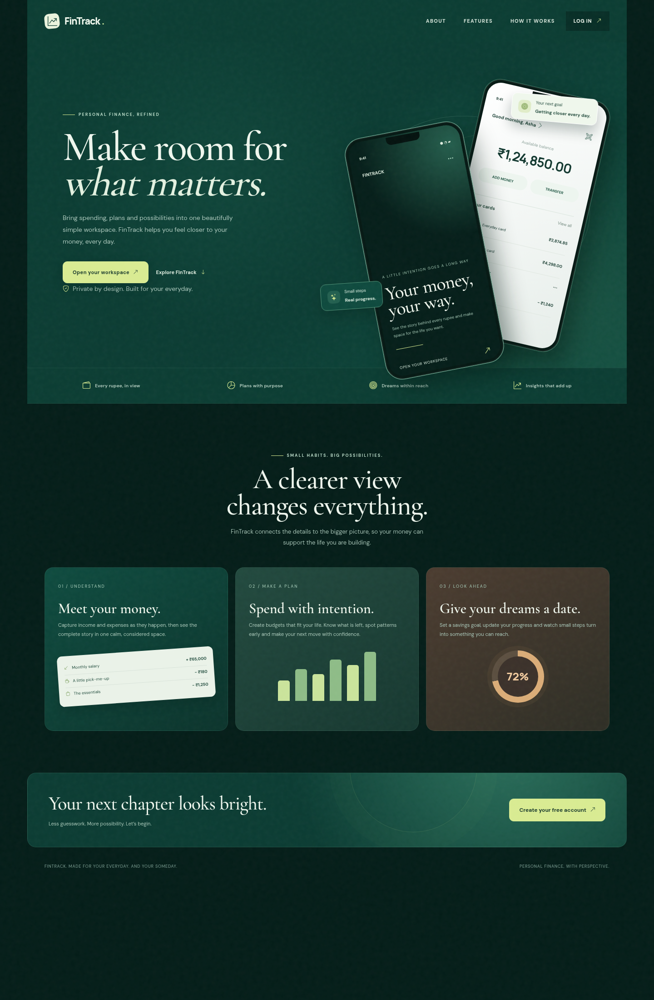
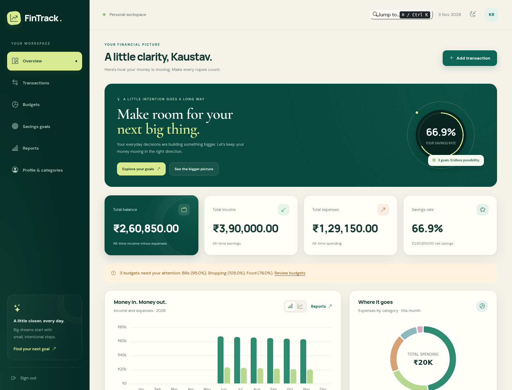

# FinTrack — Personal Finance Management System

**One working project for Java / OOP / Spring Boot and Full Stack Development evaluation.**

FinTrack is a multi-user finance workspace with a Spring Boot REST API, a MySQL database, and a responsive HTML/CSS/JavaScript frontend. It tracks income, expenses, monthly category budgets and savings goals, with database-driven charts and downloadable CSV reports. All amounts are in **Indian rupees (INR)**.

## Features

- Registration, BCrypt password hashing, JWT login, durable server-side logout revocation
- Profile editing and personal category CRUD with category/type compatibility rules
- Income/expense CRUD, backend search, category/type/payment/date filters, sorting and pagination
- Dashboard: balance, income, expenses, savings rate, monthly spending, budgets and recent activity
- Monthly budgets with calculated spending, remaining amounts and four warning levels
- Savings goals with manually updated savings, percentages, remaining amounts and deadline tracking
- Income/expense, expense-category, monthly-spending and budget-comparison charts
- Current month, previous month and custom-date reports; actual transaction and summary CSV files
- Light/dark themes, mobile navigation, accessible dialogs, validation, toasts and empty/error/loading states
- Demo data, JUnit/Mockito tests, full-stack API tests, Postman collection and academic documentation

### The Horizon frontend design

- Dark emerald, ivory and lime visual identity with editorial typography, layered cards and a responsive product landing page inspired by the supplied reference.
- Animated financial totals, scroll reveals, progress bars, card highlights, button ripples and a short goal-completion celebration. Motion respects the operating system's reduced-motion preference.
- Interactive bar/line cash-flow charts, doughnut totals, chart tooltips and a coordinated light/dark application palette.
- **Ctrl+K / ⌘K** opens quick navigation. Type a page name, use arrow keys, then Enter; Escape closes it.
- Redesigned sign-in/registration screens with password-strength feedback, visibility controls and theme switching.
- Design tokens/components live in `frontend/css/design.css`; the editorial landing composition lives in `frontend/index.html`; progressive enhancements live in `frontend/js/experience.js`. Both integrate with the existing plain-JavaScript frontend and Spring Boot API.



## Stack

| Layer | Technology |
|---|---|
| Frontend | HTML5, CSS3, JavaScript ES modules, Bootstrap 5.3.3, Bootstrap Icons 1.11.3 |
| Charts and HTTP | Chart.js 4.4.7, Fetch API, async/await |
| Backend | Java 17, Spring Boot 3.5.6, Spring MVC, Spring Security, Jakarta Validation |
| Persistence | Spring Data JPA, Hibernate, MySQL 8.0.16+ / 8.4 |
| Authentication | BCrypt cost 12, signed JWTs via JJWT 0.12.6, persistent session IDs |
| Build/test | Maven 3.9+, JUnit 5, Mockito, Spring MockMvc, H2 **test scope only** |

There is no frontend build step. MySQL is the application database; H2 is used only for isolated tests. `localStorage` stores the theme preference only; `sessionStorage` holds the current tab's bearer token. Financial records are never stored in browser storage.

## Architecture and structure

```text
Browser → REST controllers → services → repositories → Hibernate/JDBC → MySQL

FinTrack/
├── backend/
│   ├── pom.xml
│   └── src/
│       ├── main/
│       │   ├── java/com/fintrack/
│       │   │   ├── config/          Security and opt-in demo seed
│       │   │   ├── controller/      REST endpoints
│       │   │   ├── dto/             Validated requests and immutable responses
│       │   │   ├── entity/          JPA entities and enums
│       │   │   ├── exception/       Domain errors and JSON error handling
│       │   │   ├── mapper/          Entity → DTO calculations
│       │   │   ├── repository/      JPA repositories, filters, aggregate SQL
│       │   │   ├── security/        JWT principal, signing, request filter
│       │   │   ├── service/impl/    Business services and transaction implementation
│       │   │   └── util/           Financial math and date validation
│       │   └── resources/          Defaults and configuration example
│       └── test/                   JUnit/Mockito and full API integration tests
├── frontend/                       Nine HTML pages, css/, js/, assets/
├── database/                       schema.sql and optional seed.sql
├── docs/                           Architecture, API, concept mappings, 120 viva Q&As
├── postman/                        Importable end-to-end API collection
├── screenshots/                    Captures and capture guide
├── .gitignore
└── README.md
```

See [the complete file inventory](docs/file-inventory.md), [architecture](docs/architecture.md) and [database design](docs/database-design.md).

## Windows setup — exact PowerShell steps

### 1. Install prerequisites

Install a **JDK 17** (for example Eclipse Temurin), **Apache Maven 3.9+**, **MySQL Community Server 8.4** (or 8.0.16+) and VS Code. Optional VS Code extensions: Extension Pack for Java and Live Server. Add the Java, Maven and MySQL `bin` directories to Windows `PATH`, then open a **new** PowerShell window.

```powershell
java -version
mvn -version
mysql --version
Set-Location 'D:\Personal_Finance_Tracker\FinTrack'
```

Start the MySQL Windows service from Services, or in an administrator terminal (adjust the service name if yours differs):

```powershell
Start-Service MySQL84
```

### 2. Create the database and application account

From the project root:

```powershell
mysql -u root -p --execute="SOURCE D:/Personal_Finance_Tracker/FinTrack/database/schema.sql;"
mysql -u root -p
```

In the **MySQL prompt**, choose your own local database password and run:

```sql
CREATE USER 'fintrack_app'@'localhost' IDENTIFIED BY 'REPLACE_WITH_YOUR_LOCAL_DB_PASSWORD';
GRANT SELECT, INSERT, UPDATE, DELETE ON fintrack.* TO 'fintrack_app'@'localhost';
EXIT;
```

The password above is a placeholder; replace it locally. If the account already exists, use `ALTER USER` instead of `CREATE USER`. The app validates the schema and does not need DDL privileges. `schema.sql` is re-runnable for an existing matching schema, but is not a migration tool for incompatible old schemas.

### 3. Configure the application

```powershell
Set-Location 'D:\Personal_Finance_Tracker\FinTrack\backend'
Copy-Item '.\src\main\resources\application.properties.example' '.\application.properties'
$env:DB_USERNAME = 'fintrack_app'
$dbPassword = Read-Host 'Enter the fintrack_app MySQL password' -AsSecureString
$env:DB_PASSWORD = [System.Net.NetworkCredential]::new('', $dbPassword).Password
$bytes = New-Object byte[] 48
$rng = [System.Security.Cryptography.RandomNumberGenerator]::Create()
$rng.GetBytes($bytes)
$rng.Dispose()
$env:JWT_SECRET = [Convert]::ToBase64String($bytes)
$env:CORS_ORIGINS = 'http://localhost:5500,http://127.0.0.1:5500'
```

`backend/application.properties` is loaded automatically from the backend working directory and is ignored by Git. The tracked configuration contains environment references, never real credentials. Set `DB_URL` if you use environment-only configuration; if using the copied example file, edit its `spring.datasource.url` and `spring.datasource.username` when using a nondefault database location/account. A local property value overrides the packaged default.

The default DB URL is `jdbc:mysql://localhost:3306/fintrack?useSSL=false&allowPublicKeyRetrieval=true&serverTimezone=UTC`, intended for local development. Use certificate-verified database TLS and HTTPS for a hosted deployment. Keep the same JWT secret across restarts if existing sessions should remain valid; changing it signs out existing tokens. The generated value above exists only in this PowerShell session.

### 4. Optional populated demo

Before starting the API in the same terminal:

```powershell
$env:DEMO_ENABLED = 'true'
$env:DEMO_PASSWORD = 'DemoPass123!'
```

This creates **Kaustav Roy**, `roykaustav382@gmail.com`, with the explicitly chosen demo password **`DemoPass123!`**, 7 categories, 42 transactions over six months, 4 current-month budgets and 3 goals. The password is hashed at startup. If this email already exists, the seeder leaves it untouched, including its existing password. Use these public example credentials for demo data only. The seeder is disabled by default.

Alternatively register `roykaustav382@gmail.com` through the UI and run `database/seed.sql` for a smaller seed; use one seed method per account.

### 5. Start the backend

```powershell
mvn spring-boot:run
```

Backend base URL: **http://localhost:8080**. API prefix: **http://localhost:8080/api**. The backend serves JSON APIs; opening `/` in a browser is not the frontend.

### 6. Start the frontend in another terminal

**VS Code Live Server:** open the `frontend` folder as the workspace and use “Open with Live Server” on `index.html`. Configure Live Server port **5500** if needed.

Or, with Python installed:

```powershell
Set-Location 'D:\Personal_Finance_Tracker\FinTrack\frontend'
py -m http.server 5500 --bind 127.0.0.1
```

Frontend: **http://localhost:5500**. Login: **http://localhost:5500/login.html**. Open it through HTTP, not `file://`, because ES modules and Fetch need a server. The API address is centralized in `frontend/js/config.js`.

Bootstrap, icons, fonts and Chart.js load from CDNs, so internet access is needed. The browser shows a useful chart error if Chart.js cannot load.

### 7. Demonstrate the complete flow

1. Register, or log in with the opt-in demo credentials.
2. Review the dashboard and compare totals with transactions.
3. Add an expense; edit it; filter/search it; export CSV; delete it through the confirmation dialog.
4. Create a category in Profile, use it for a transaction and inspect deletion protection.
5. Create a monthly budget; add matching expenses; show warning thresholds.
6. Create a savings goal and update saved amount; inspect progress and remaining days.
7. Generate current/previous/custom-date reports and download report and transaction CSVs.
8. Update your profile; switch themes; test mobile navigation.
9. Sign out and verify that the previous bearer token no longer accesses the API.

## API overview

| Area | Base endpoints |
|---|---|
| Auth | `POST /api/auth/register`, `/login`, `/logout` |
| Profile | `GET`, `PUT /api/users/me` |
| Transactions | `GET`, `POST /api/transactions`; `GET`, `PUT`, `DELETE /api/transactions/{id}`; `GET /api/transactions/export` |
| Categories | `GET`, `POST /api/categories`; `PUT`, `DELETE /api/categories/{id}` |
| Budgets / Goals | List/create and individual get/update/delete at `/api/budgets` and `/api/goals` |
| Dashboard | `/api/dashboard/summary`, `/monthly`, `/category-expenses`, `/recent-transactions` |
| Reports | `/api/reports/monthly`, `/category`, `/date-range`, `/export` |

All except registration and login require `Authorization: Bearer <token>`. Users cannot choose an owner ID. Foreign resources return 404 to avoid disclosing their existence. Full requests, response schemas, status codes and query parameters: [API documentation](docs/api-documentation.md).

## Tests

```powershell
Set-Location 'D:\Personal_Finance_Tracker\FinTrack\backend'
mvn test
mvn verify
```

Tests use an isolated H2 database and test-only signing key; they do not need your MySQL or development secrets. The 30 tests cover BCrypt registration/login, transaction CRUD, ownership, query validation, budget thresholds, goal calculations, dashboard aggregates, reporting, CSV safety, CORS and JWT logout revocation. See [testing](docs/testing.md) for a dedicated MySQL test run and browser checks.

Import `postman/FinTrack.postman_collection.json`. Set collection variable `password` to a valid test password, then run the collection in order. It creates a fresh fake account, captures its token/IDs, exercises all routes, and deletes the resources it created before logging out.

## Academic evaluation

- [Java concept mapping](docs/java-concepts.md): exact classes and methods to explain
- [FSD concept mapping](docs/fsd-concepts.md): browser, HTTP and database integration
- [120 viva questions with answers](docs/viva-questions.md): 30 Java, 30 Spring, 20 SQL, 20 FSD, 20 project-specific
- [HOW TO PRESENT FINTRACK](docs/presentation.md): demonstration sequence for all evaluations
- [Final verification](docs/verification.md): executed checks and remaining manual checks

## Screenshots

See [screenshots](screenshots/README.md) for captured views and the presentation screenshot checklist.



## Troubleshooting

| Symptom | Fix |
|---|---|
| `java` not recognized | Install JDK 17, set `JAVA_HOME` to the JDK root, add `%JAVA_HOME%\bin` to PATH, reopen terminal. |
| `mvn` not recognized | Add Maven's `bin` directory to PATH; verify `mvn -version` reports Java 17. |
| MySQL connection refused | Start the MySQL service; check host/port in datasource URL. |
| MySQL access denied | Check the app account and local password; test `mysql -u fintrack_app -p fintrack`. |
| Schema validation failure | Import `schema.sql` into the exact database named in the datasource URL. Do not set production `ddl-auto=create`. |
| Unresolved `DB_PASSWORD` / `JWT_SECRET` | Set them in the terminal that launches Maven, or set the corresponding properties in the ignored local file. |
| CORS error | Match the frontend's exact origin including scheme and port in `app.cors.origins` / `CORS_ORIGINS`, then restart. |
| Port 8080 in use | `$env:PORT='8081'` then restart; set `API_BASE_URL` in `frontend/js/config.js` to port 8081. |
| Frontend port differs | Change the CORS allowlist to that port and restart the API. |
| Blank module page with `file://` | Serve the frontend using Live Server or Python. |
| Charts/icons not visible | Check CDN connectivity and browser console; vendor these dependencies for offline presentation. |
| 401 after restart | The signing key changed, session expired, or you logged out. Sign in again. |
| Demo login fails | Seeding is opt-in and skips an existing email; use the password chosen when the account was created. |
| Goal edit does not change balance | By design: goals track allocation progress, not an additional cash flow. |

## Scope and future enhancements

Required features are implemented. Optional PDF export, a financial-health score and background report jobs are deliberately omitted. Savings rate and budget warning rules are transparent; the app makes no financial-advice claims. Useful extensions: verified-email/password-reset workflows, MFA, recurring transactions, account-level multi-currency balances, audited concurrent updates, rate limiting at a deployment gateway, schema migrations, scheduled encrypted backups, and self-hosted frontend dependencies.

The repository is GitHub-ready. No commit or remote publication is performed automatically; inspect the ignored configuration and staged files before publishing.
