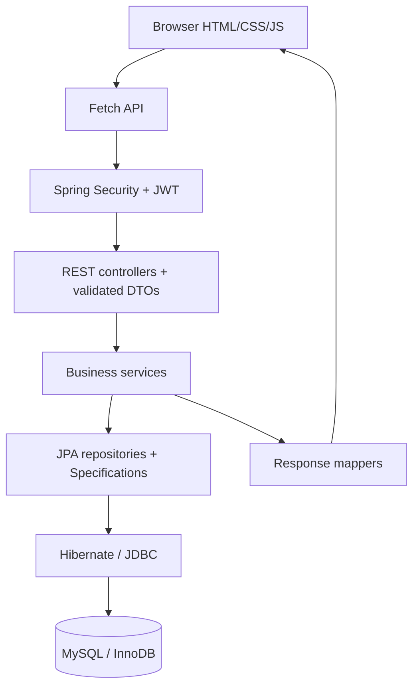

# Architecture

## Request lifecycle

1. A page module calls `api.js`; the centralized Fetch helper adds the bearer token.
2. Spring Security applies a specific CORS allowlist and the JWT authentication filter.
3. `JwtService` verifies the signature, issuer and expiration. `AuthSessionRepository` verifies the JWT ID belongs to this user and is still active.
4. A controller binds URL/body values into DTOs and invokes Jakarta validation.
5. Services enforce ownership and business rules in transaction boundaries.
6. Spring Data repositories generate parameterized JDBC queries through Hibernate.
7. `FinanceMapper` produces password-free response DTOs. The UI renders escaped data and real charts.

## Main design choices

- **Layered monolith:** easy to run, test and explain. Each domain has a small service/controller instead of a single application-sized class.
- **Immutable boundary data:** Java records in `Requests` and `Views`. Entities remain internal; passwords cannot leak through DTO serialization.
- **Meaningful abstraction:** `TransactionService` is an interface with `TransactionServiceImpl`. Other single-implementation services remain ordinary classes to avoid ceremony.
- **Natural inheritance:** `BaseEntity` owns generated IDs, timestamps and JPA lifecycle callbacks. Financial entities inherit these common persistence concerns.
- **Relationships:** lazy `ManyToOne`; inverse `OneToMany` collections on user/category; explicit deletes with no cascade removal of financial history. No blanket `CascadeType.ALL`.
- **Read boundaries:** `spring.jpa.open-in-view=false`; DTO mapping happens within read-only service transactions. Transaction queries fetch their category to avoid N+1 selects.
- **Aggregates:** dashboard/report repositories use `SUM`, `COUNT`, `MAX` and `GROUP BY`. A budget list loads one category-total query for the selected month rather than one query per budget.
- **Money:** `BigDecimal` and MySQL `DECIMAL(15,2)`; averages/percentages use `HALF_UP` to two decimals. JavaScript displays these values; canonical calculations belong to the backend.
- **CSV:** Java `Writer`/`OutputStream` handling, UTF-8 BOM, quoted/escaped cells and formula-prefix neutralization. Transaction export reads 100 records at a time in one read-only transaction. Memory use is bounded by page size.
- **Browser architecture:** ES modules and reusable UI/form helpers; one HTTP helper; user strings are escaped before HTML interpolation. Dialogs use native keyboard/focus semantics and Bootstrap styling.

## Authentication decisions

JWTs expire in 120 minutes by default. A signed token contains only user ID, issuer, issued/expiry times and random session ID, not financial records. Its ID is stored in `auth_sessions`, so logout invalidates an already-issued token immediately and revocation survives a backend restart. The API uses no HTTP session or authentication cookies; CSRF protection is disabled for this bearer-header model. A scheduled hourly job deletes expired session records. There is no refresh-token flow: sign in again after expiry.

The browser token is in `sessionStorage` to support navigation in the current tab. It is accessible to same-origin JavaScript, so the frontend avoids untrusted HTML execution. Use HTTPS and tightly controlled static assets when deploying. The theme is the only `localStorage` value.

## Business rules

- Transaction amounts and budget limits are positive, at most 13 integer digits and 2 fractional digits. Transaction dates cannot be in the future.
- Category names are unique within a user. `BOTH` can support either type. Budgets use expense-capable categories.
- Categories in use cannot be deleted or have their type changed; renaming is allowed and history shows the current category name.
- A category has at most one budget per user/month/year. Supported budget years: 2000–2100.
- Warning thresholds on the two-decimal usage percentage: `<75 NORMAL`, `75–<90 WARNING`, `90–100 CRITICAL`, `>100 EXCEEDED`.
- Remaining budget may be negative; aggregate budget usage covers only budgeted categories.
- Goal target is positive; saved amount is between zero and target. Deadlines may be past (overdue) with year 2000–2100. Days remaining are signed calendar days.
- Goals are independent manual savings allocations; they do not automatically debit balances.
- Balance and net savings are income minus expenses. Savings rate is net savings / income × 100, or 0 if income is zero. Negative savings rates are valid.
- Report average is `(sum of all income amounts + sum of all expense amounts) / transaction count`; highest expense excludes income.
- App dates use the server's local calendar; audit timestamps are UTC instants. A single-server academic deployment should choose its desired time zone consistently.

## Error semantics

400 validation/business input error; 401 missing/invalid credentials; 403 forbidden request such as disallowed CORS origin; 404 absent or foreign-owned resource; 409 duplicate/in-use resource; 405 unsupported HTTP method; 500 generic unexpected failure. Database integrity violations are mapped to 409 without exposing SQL or stack traces. Ownership deliberately uses scoped queries instead of revealing that another user owns a specific ID.

## Scope boundaries

No artificial asynchronous financial processing: normal CRUD is transactional and synchronous. The scheduled session cleanup is genuinely useful background work. Health score/PDF/bank synchronization are optional future work. Offset pagination and infix text search suit an academic/local deployment; very large installations can add keyset pagination and indexed full-text search. Unbounded lifetime aggregate results remain grouped small results, not full transaction downloads.
