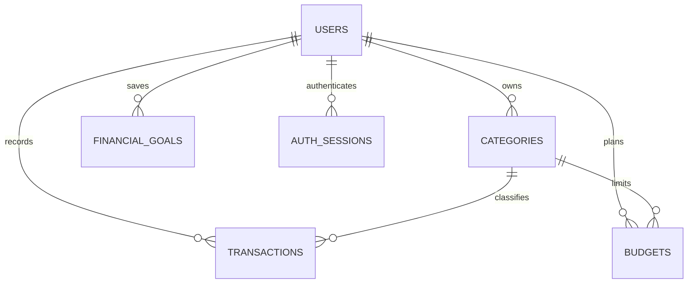

# Database design

Canonical DDL: [`database/schema.sql`](../database/schema.sql). Use MySQL 8.0.16+ so CHECK constraints are enforced. All tables use InnoDB; the database uses `utf8mb4_0900_ai_ci` for Unicode and case-insensitive uniqueness.

## Tables and types

| Table | Main columns | Constraints |
|---|---|---|
| users | BIGINT id; VARCHAR name(100), email(254), password(60), phone(20); DATETIME(6) timestamps | PK id; unique email; required name/email/password |
| categories | BIGINT id/user_id; VARCHAR name(60); ENUM type; timestamps | unique(user_id,name); FK user; unique(id,user_id) for composite ownership FK |
| transactions | BIGINT id/user_id/category_id; DECIMAL(15,2) amount; ENUM type/payment_method; VARCHAR description(500); DATE transaction_date; timestamps | amount > 0; user FK; composite category/owner FK |
| budgets | BIGINT id/user_id/category_id; DECIMAL(15,2) amount; INT budget_month/budget_year; timestamps | amount > 0; month 1–12; year 2000–2100; unique user/category/month/year |
| financial_goals | BIGINT id/user_id; VARCHAR goal_name(100); DECIMAL(15,2) target_amount/saved_amount; DATE deadline; timestamps | target > 0; 0 ≤ saved ≤ target; user FK |
| auth_sessions | VARCHAR(36) id; BIGINT user_id; DATETIME(6) expires_at | PK random session UUID; FK user; expiry index |

`month` and `year` are API/entity property names. Physical SQL names are `budget_month` and `budget_year` to avoid ambiguous SQL keywords. Categories also have `updated_at`, inherited consistently from `BaseEntity`.

## Index rationale

- `users(email)` supports authentication and uniqueness.
- `categories(user_id,name)` supports personal category lookup and uniqueness.
- `transactions(user_id,transaction_date)` supports scoped date filtering and reports.
- `(user_id,type,transaction_date)` and `(user_id,category_id,transaction_date)` support grouped spending and category filters.
- `(user_id,amount)` supports amount sorting; description infix search is intentionally not claimed to be index-backed.
- Budget unique key rejects duplicate category plans; `(user_id,budget_year,budget_month)` supports month lists.
- `(user_id,deadline)` supports goal ordering; session expiry index supports cleanup.

Composite transaction/budget foreign keys `(category_id,user_id)` reference `categories(id,user_id)` so an accidental cross-user category association is rejected by MySQL as well as services. The Hibernate mapping uses ordinary relationships while the SQL schema supplies this extra integrity constraint.

## Normalization

Each record has a single primary key. User information exists only in users; category names exist only in categories. Transactions/budgets refer to categories through keys rather than duplicating labels. Computed balances, budget spending, percentages and goal days are not stored, avoiding stale derived values. A session table supports persistent revocation without storing passwords or full JWT strings.

## Deletion and transactions

Financial records are deleted explicitly by scoped service methods. User/category deletion does not cascade into history. Referenced category deletes fail with a 409; remove or reassign dependent records first. Service write methods use `@Transactional`. Database unique constraints handle races that bypass optimistic prechecks.

## Seed and configuration

`DemoDataSeeder` is the recommended opt-in seed. It invokes actual application services and BCrypt, creates six months of fake data, and runs atomically. The alternative `seed.sql` expects `roykaustav382@gmail.com` to have been registered and never stores a raw password. Both are documented in the root README.

The runtime account needs SELECT/INSERT/UPDATE/DELETE only. Import schema as a database administrator. Hibernate `validate` checks compatibility at startup rather than silently recreating tables. Use backups and an explicit migration tool for future schema revisions.
